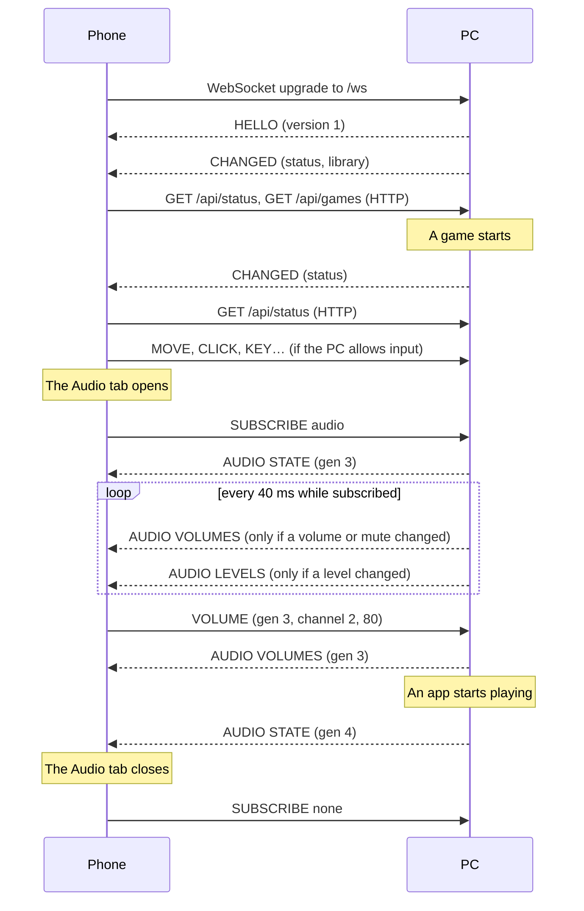

# The live socket protocol

The phone and the PC talk over one WebSocket. Up it go the touchpad, the keyboard and the mixer's commands; down it comes word of what changed on the PC, and the audio mixer, levels included, 25 times a second.

The socket carries only small binary messages. Structured data stays JSON on plain HTTP under `/api`: the PC's status (`GET /api/status`), the game library (`GET /api/games`) and how Playnite shows it (`GET /api/library`), cover art, and actions such as starting a game or applying a display preset. When the status or the library changes, the socket says so with a two-byte CHANGED and the phone fetches the JSON again. Nothing polls.

This document is the specification. The implementations must follow it byte for byte:

| Side | File | Covers |
|---|---|---|
| PC | `src/CouchPilot/Server/LiveSocket.cs` | connection, HELLO, CHANGED, SUBSCRIBE, dispatch, timing |
| PC | `src/CouchPilot/Server/StatusSource.cs` | what counts as a status change |
| PC | `src/CouchPilot/Audio/AudioProtocol.cs` | audio messages, encoding |
| PC | `src/CouchPilot/Audio/AudioService.cs` | audio commands, channels, generations |
| PC | `src/CouchPilot/Input/RemoteInput.cs` | mouse and keyboard commands |
| Phone | `web/src/protocol.ts` | every opcode, decoding and encoding |
| Phone | `web/src/live.ts`, `store.ts`, `audio.ts`, `input.ts` | connection, fetching on CHANGED, audio, input |
| Phone | `web/src/mock.ts` | a pretend PC speaking the same bytes, for `pnpm dev:mock` |

Change one, change this document and the others in the same commit.

## Contents

1. [Connection](#1-connection)
2. [Encoding](#2-encoding)
3. [Opcodes](#3-opcodes)
4. [A session, start to finish](#4-a-session-start-to-finish)
5. [PC → phone](#5-pc--phone): HELLO, CHANGED, AUDIO STATE, AUDIO VOLUMES, AUDIO LEVELS
6. [Phone → PC](#6-phone--pc): mouse and keyboard, audio commands, SUBSCRIBE
7. [The audio model](#7-the-audio-model)
8. [Timing](#8-timing)
9. [Errors and edge cases](#9-errors-and-edge-cases)
10. [Versioning](#10-versioning)

## 1. Connection

- **URL:** `ws://<pc>:<port>/ws`, on the same port as the web app (8642 by default).
- **Origin:** the PC accepts the connection only if the `Origin` header is missing or names the same host and port as the `Host` header. WebSockets skip the browser's same-origin rules; without this check any web page open on a device on the network could type on the PC.
- **Frames:** binary only. Text frames are ignored.
- **Size:** at most 16 KiB per message from the phone. Messages from the PC have no limit, but in practice the largest is an AUDIO STATE of a few hundred bytes.
- **Lifetime:** the phone opens the socket while the page is on screen and closes it when the page goes to the background (`visibilitychange`). After an unexpected close it reconnects after 0.4 s, 0.8 s, 1.6 s, 3.2 s, then every 5 s.
- **Offline:** the phone shows the PC as offline only after 3 s without a connection, so a brief drop doesn't flash.
- **Authentication:** none by default: the port must not be exposed beyond the local network (see the README). With **Ask new phones for a PIN** on in the extension settings, the upgrade must carry the `couchpilot_device` cookie of a paired phone, like every request under `/api` (see [1.1](#11-pairing)); without it the PC closes the socket with status 1008 and the reason `unpaired`, and the phone shows its pairing screen instead of reconnecting.

### 1.1 Pairing

Optional. While it's on, `/api` answers only phones that have typed a PIN once: a request without a known cookie gets `401 {"error": …, "code": "unpaired"}`, whatever the path, except the three pairing routes and the app's own files. The phone then:

1. `POST /api/pair/request` with `{"name": "Pixel 8 · Chrome"}`. The PC puts a six-digit PIN on its screen (and in Playnite's notifications) for two minutes and answers `{"expiresAt": "…", "seconds": 120}`. At most one request every 5 s (`409`, code `too-soon`).
2. `POST /api/pair` with `{"pin": "482913", "name": "…"}`. Right: `200` with the device (`{"id", "name", "input", "captures"}`) and a `Set-Cookie` for `couchpilot_device`, HttpOnly, SameSite=Lax, Secure over HTTPS, good for 400 days and renewed daily while the phone comes back. The body also carries the token (`"token": "…"`) for the phone to keep a copy of (see 4 below). Wrong: `403`, code `wrong-pin`, with `attemptsLeft`; after five wrong tries, or two minutes, `409` with code `expired` and the phone has to ask again.
3. `GET /api/pair` says whether pairing is required, which device the cookie stands for and, for a known one, its `token`; `DELETE /api/pair` forgets this phone.
4. Browsers drop cookies on their own, so the phone keeps the token in `localStorage` too. On `unpaired` it first sends `POST /api/pair/resume` with `{"token": "…"}`: a device the PC still knows gets its cookie back and the device in the body, no PIN; one removed in the settings gets `409`, code `forgotten`, and the phone forgets the copy and asks for a PIN.

The token is 32 random bytes; the PC keeps only its SHA-256 (`devices.json` in the extension's data folder). Each paired phone can separately be allowed, or not, to use mouse and keyboard and to see the captures: `input` and `capture` in `/api/status` are already narrowed to the phone asking, and input messages from a phone that may not send them are dropped like when input is off.

## 2. Encoding

Every message is one WebSocket frame. Its first byte is the **opcode**, followed by the opcode's fields in the order given, without padding or separators.

| Type | Size | Meaning |
|---|---|---|
| `u8` | 1 | unsigned integer, 0–255 |
| `i16` | 2 | signed integer, **little-endian**, −32768–32767 |
| `str` | 1 + n | a `u8` byte count n (0–255), then n bytes of UTF-8. Longer text is cut by the sender at a character boundary, never inside one |
| `guid` | 16 | a Playnite id as raw bytes, **big-endian in the order its text form reads**: `6de22bd5-1691-40df-9a93-4a319d8f2d3a` is `6d e2 2b d5 16 91 40 df 9a 93 4a 31 9d 8f 2d 3a`. This is *not* .NET's `Guid.ToByteArray()` order |
| `utf8…` | rest | UTF-8 up to the end of the message, no length prefix |
| `json…` | rest | UTF-8 JSON up to the end of the message |

Flags are bit sets in a `u8`. Bit values are given as numbers (1, 2, 4…). Bits this document doesn't name must be sent as 0 and ignored on receipt.

## 3. Opcodes

The first byte tells the reader both the direction and the subsystem.

| Range | Direction | Subsystem |
|---|---|---|
| `0x01`–`0x0F` | phone → PC | mouse and keyboard |
| `0x10`–`0x1F` | phone → PC | audio commands |
| `0x20`–`0x2F` | phone → PC | the connection itself |
| `0x30`–`0x7F` | — | reserved |
| `0x80`–`0x8F` | PC → phone | state |
| `0x90`–`0xFF` | — | reserved |

| Op | Name | Direction | Section |
|---|---|---|---|
| `0x01` | MOVE | phone → PC | [6.1](#61-mouse-and-keyboard-0x010x0f) |
| `0x02` | WHEEL | phone → PC | 6.1 |
| `0x03` | DOWN | phone → PC | 6.1 |
| `0x04` | UP | phone → PC | 6.1 |
| `0x05` | CLICK | phone → PC | 6.1 |
| `0x06` | KEY | phone → PC | 6.1 |
| `0x07` | CHAR | phone → PC | 6.1 |
| `0x08` | TEXT | phone → PC | 6.1 |
| `0x10` | VOLUME | phone → PC | [6.2](#62-audio-commands-0x100x1f) |
| `0x11` | MUTE | phone → PC | 6.2 |
| `0x12` | DEFAULT | phone → PC | 6.2 |
| `0x20` | SUBSCRIBE | phone → PC | [6.3](#63-subscribe-0x20) |
| `0x80` | HELLO | PC → phone | [5.1](#51-hello-0x80) |
| `0x81` | CHANGED | PC → phone | [5.2](#52-changed-0x81) |
| `0x82` | AUDIO STATE | PC → phone | [5.3](#53-audio-state-0x82) |
| `0x83` | AUDIO VOLUMES | PC → phone | [5.4](#54-audio-volumes-0x83) |
| `0x84` | AUDIO LEVELS | PC → phone | [5.5](#55-audio-levels-0x84) |

A receiver **ignores an opcode it doesn't know**: it comes from a newer peer, and skipping it must be safe. That is the rule that lets the protocol grow without breaking older phones or PCs.

## 4. A session, start to finish



## 5. PC → phone

### 5.1 HELLO `0x80`

The first message on every connection.

| Offset | Field | Type | |
|---|---|---|---|
| 0 | op | `u8` | `0x80` |
| 1 | version | `u8` | the protocol version, currently `1` |

```
80 01
```

If the version isn't the one the page was built for, the page is a stale copy of the app (the PC was updated, the phone kept the old one cached). The phone reloads itself to get the app the PC serves now, at most once a minute so that a mismatch reloading can't fix doesn't loop.

### 5.2 CHANGED `0x81`

Some structured data on the PC changed: the phone should fetch it again over HTTP.

| Offset | Field | Type | |
|---|---|---|---|
| 0 | op | `u8` | `0x81` |
| 1 | topics | `u8` | flags, below |

| Bit | Topic | Fetch again |
|---|---|---|
| 1 | status | `GET /api/status` |
| 2 | library | `GET /api/games` |
| 4 | media | `GET /api/media` |
| 8 | captures | `GET /api/captures` |
| 16 | achievements | `GET /api/achievements/recent` |
| 32 | stats | `GET /api/stats`, `GET /api/games/{id}/stats` (whichever is on screen) |
| 64 | view | `GET /api/library` |

```
81 01      the status changed
81 03      the status and the library changed
```

Right after HELLO the PC sends CHANGED with every topic set (`81 7F`), so a phone that just connected, or reconnected after missing changes, refreshes everything.

**Why not send the data itself.** Status and library are nested, vary in shape and change a few times a minute at most. As JSON on HTTP they keep one schema, readable with a browser or `curl`, and need no binary layout to keep in step with it. The socket only carries what has to be immediate or compact. One round trip after a CHANGED costs a few milliseconds on a home network.

**Status.** The PC compares the status about twice a second, and on the next tick after anything it knows changes it: a game starting or stopping, a preset applied, kept, reverted, saved, renamed or deleted, the input setting toggled. A controller connecting, disconnecting or changing battery level shows up at the next twice-a-second check. CHANGED goes out only if the status differs from the last one announced, **ignoring `displays.pending.secondsLeft`**: the countdown alone isn't news, and the phone counts down by itself from the value it fetched.

**Library.** Sent when Playnite adds, removes or updates a game: an import, an install, the playtime after a session, a cover downloaded. The statistics (`GET /api/stats`, `GET /api/games/{id}/stats`) refresh on it too: a session ending updates the game's playtime, and the game that stopped no longer counts as running. An import can update hundreds of games in a row, so the PC announces the library at most twice a second.

**View.** Sent on the next tick after Playnite's library view changes: another filter preset, sort, grouping or filter, whether picked on the PC or from a phone. Playnite has no event for it, so the PC compares the view once a second. The phone also fetches the view again on a library CHANGED, since a game changing can move it in the view, or in or out of it.

**Media.** Sent on the next tick after Windows reports that what plays changed: another track, play or pause, another app taking over. Not for the position moving on: `/api/media` gives the position as of when it answered, and the phone moves the bar from there while playing.

**Captures.** Sent on the next tick after a screenshot or clip appears in, or leaves, the capture folders: made from the phone or with the PC's own keys, or deleted. A file being written (a clip being encoded, a recording under way) counts once its writer lets go of it. The phone fetches the list only while captures are on (`capture` in the status isn't null).

**Achievements.** Sent on the next tick after SuccessStory (if installed) writes a game's achievements file, which it does at the end of a session, or during one if it's set to refresh while you play. The phone fetches the latest unlocked and announces the ones it hadn't seen. The phone fetches them only while `achievements` in the status is true.

**Stats.** Sent on the next tick after GameActivity (if installed) writes, renames or deletes a game's file in its data folder, once its writes have been quiet for about a second. It writes a session down when the game closes, a few seconds after Playnite's own update of the playtime (the library above), so the statistics catch the session that just ended. The captures topic goes out with it: a capture saved in those seconds belongs to the game whose session has just been written. The statistics' JSON carries `activity: false` when GameActivity's data isn't there, or GameActivity is turned off in the settings: then there are no sessions, only Playnite's totals. Turning SuccessStory or GameActivity on or off in the settings sends status, stats and captures.

**The phone** keeps at most one fetch per topic in flight. A CHANGED arriving during a fetch queues exactly one more, so a burst of changes costs two requests at most.

`GET /api/status` returns (property names camelCase):

```jsonc
{
  "pc": "PC-GAMING",                      // the PC's name
  "running": [                            // games Playnite started, oldest first
    {
      "id": "6de22bd5-1691-40df-9a93-4a319d8f2d3a",
      "name": "Hades II",
      "source": "Steam",
      "startedAt": "2026-10-05T18:02:11.0000000Z",  // null if running before Playnite started
      "hasCover": true,
      "hasBackground": true
    }
  ],
  "displays": {
    "monitors": [                         // the layout right now
      { "name": "LG TV SSCR2", "devicePath": "\\\\?\\DISPLAY#…", "x": 0, "y": 0,
        "width": 3840, "height": 2160, "refreshHz": 120, "primary": true, "virtual": false }
    ],
    "presets": [ { "id": "…", "name": "Solo TV", "monitors": [ /* as above */ ] } ],
    "activePresetId": "…",                // the preset matching the layout, or null
    "pending": {                          // a preset on trial, or null
      "presetId": "…",
      "previousPresetId": "…",            // what to roll back to, or null
      "secondsLeft": 12                   // until the PC rolls back by itself
    },
    "streamActive": false                 // a Vibepollo stream owns the displays
  },
  "input": true,                          // the phone may use mouse and keyboard
  "capture": {                            // screenshots and clips, or null when off in the settings
    "tool": "gamebar",                    // or "nvidia": whose shortcuts the PC presses
    "recordingSince": null,               // when the recording started from the phone began
    "replaySeconds": 30                   // how much a replay keeps, when the tool says; null otherwise
  },
  "controllers": [                        // Xbox-style pads (XInput), by slot
    { "slot": 1, "wired": false, "battery": "medium" },  // empty, low, medium, full
    { "slot": 2, "wired": true, "battery": null }        // null when wired or unknown
  ],
  "pairing": true,                        // phones have to type a PIN (see 1.1)
  "device": { "id": "a1b2c3d4e5f6", "name": "Pixel 8 · Chrome", "input": true, "captures": true },  // this phone; null while pairing is off
  "achievements": true                    // SuccessStory is installed, has data and isn't turned off in the settings
}
```

`input` and `capture` are what the settings allow **and** what this phone is allowed: with pairing on, a phone the settings don't let use mouse and keyboard sees `input: false`, one that may not see the captures sees `capture: null`. `capture.editing` says whether clips can be cut on the PC (the bundled ffmpeg is there).

`GET /api/media` returns what Windows' media controls show, or `null` when nothing plays:

```jsonc
{
  "title": "Lumière",
  "artist": "Lorien Testard",
  "album": "Clair Obscur: Expedition 33",
  "app": "Spotify.exe",                   // Windows' id for the app playing it
  "playing": true,
  "canPlayPause": true, "canNext": true, "canPrevious": true,
  "positionSeconds": 42.6,                // as of readAt; null with durationSeconds when unknown
  "durationSeconds": 264,
  "readAt": "2026-10-05T18:30:02.1234567Z",
  "artVersion": "7"                       // null without artwork
}
```

The artwork is at `GET /api/media/art?v=<artVersion>`; the version changes with the art, so the image can be cached for good. Play/pause and skipping are `POST /api/media/play-pause`, `/api/media/next` and `/api/media/previous` (409 if the app refuses).

`GET /api/captures` returns the screenshots and clips in Game Bar's and NVIDIA's folders (and the extra one from the settings), newest first; 403 while captures are off:

```jsonc
{
  "items": [
    {
      "id": "3f2a…",                       // stable for the file's path
      "kind": "video",                     // or "photo"
      "replay": true,                      // a clip of what just happened
      "takenAt": "2026-10-05T19:42:13.0000000Z",
      "bytes": 48213004,
      "width": 2560, "height": 1440,       // null when the file doesn't say
      "seconds": 30.02,                    // clips only
      "gameId": "6de22bd5-…",              // the GameActivity session (or the game running) it falls in, else the game its name matches, else null
      "game": "Elden Ring",                // that game's name, else what the tool called the window, else null
      "tool": "gamebar",                   // "nvidia", or null for the extra folder
      "fileName": "Elden Ring 2026-10-05 21-42-13.mp4",
      "version": "8dce53a1f7c4b20"         // changes with the file
    }
  ],
  "bytes": 18400000000,                    // all of them together
  "folders": ["C:\\Users\\pc\\Videos\\Captures"]  // the folders that exist
}
```

The thumbnail is at `GET /api/captures/{id}/thumb?v=<version>` (a JPEG up to 480 px, cacheable for good; 404 when the PC can't make one, a damaged clip say), the file at `GET /api/captures/{id}/file`, which honours `Range` so the player can seek. Screenshots also have a preview at `GET /api/captures/{id}/preview?v=<version>`, a JPEG up to 1920 px for the viewer, so a 4K PNG of tens of MB isn't fetched just to look at it (cacheable for good; 404 for clips, GIFs, and a file the PC can't read, where the viewer falls back to the file); saving and sharing still take the file. `DELETE /api/captures/{id}` moves it to the PC's Recycle Bin.

**Light copies of clips.** The capture tools write tens of Mbit/s, which the house's Wi-Fi often can't keep up with, so the viewer plays a light copy the PC makes with the bundled ffmpeg: long side at most 1280 px, at most 30 frames a second, H.264 capped at 4 Mbit/s with a keyframe every two seconds and its index up front, AAC stereo from the first sound track, HDR tone-mapped. `GET /api/captures/{id}/light` says where it stands, `POST` the same and has it made next:

```jsonc
{ "state": "making", "progress": 0.42, "bytes": null }
```

`state` is `ready` (`bytes` is its size), `queued`, `making` (`progress` from 0 to 1), `none` (not made, nobody asked: GET only) or `original`: play the file itself, because it's light enough already (6 Mbit/s or less), the PC has no ffmpeg with x264, or making it failed. The copy is at `GET /api/captures/{id}/light/file?v=<version>`, in ranges like the file (cacheable for good; 404 until ready). Copies are made one at a time at below-normal priority, the one a phone asked for first; the newest clips are also made ahead, but only while no game is running. They're kept with the extension's data (`previews`), up to 4 GB, the ones watched least recently going first; deleting a clip deletes its copy.

Each item also carries `edited` (cut out of another clip on the phone) and `sourceId` (that clip's id, while it's still there). GIFs the editor made are listed as photos (`kind: "photo"`, a `.gif` file name).

**Cutting a clip.** `GET /api/captures/{id}/strip?v=<version>` is a strip of 12 frames across the clip, side by side in one JPEG 160 px a frame, for the trimmer's handles (cacheable for good; 404 without ffmpeg or for a clip it can't read). `POST /api/captures/{id}/trim` with

```jsonc
{ "from": 12.4, "to": 41.0, "format": "mp4", "audio": true }   // or "format": "gif" (no audio, at most 20 s)
```

makes the PC write that piece next to the clip, dated like the moment it starts so the gallery lists the two together under the same game, and answers once ffmpeg is done, with the new capture as above. MP4s are re-encoded (H.264, AAC, at most 1080p, HDR tone-mapped) so the cut lands on the frame asked for; GIFs are 480 px wide at 15 fps with a palette of their own. One cut at a time. Errors are `409` with a `code`: `no-ffmpeg`, `not-video`, `too-short` (under 0.5 s), `too-long` (a GIF over 20 s), `busy`, `trim-failed`.

`POST /api/captures/screenshot`, `/api/captures/replay` and `/api/captures/record/stop` press the tool's shortcut and answer once the new file is on disk, with it as above; `/api/captures/record/start` answers at once. When they can't, the answer is 409 with a `code` besides the `error`:

| `code` | Meaning |
|---|---|
| `capture-off` | Game Bar's captures are turned off in Windows |
| `replay-off` | no replay to save: Game Bar isn't recording in the background, or (NVIDIA) no clip came, so Instant Replay is probably off |
| `nothing-saved` | the shortcut went out but no file came (the game not in the foreground, say) |
| `busy` | another capture is still on its way, or a recording is under way (replay) |
| `off` | captures are off in the extension settings |

`GET /api/games` returns the library: every game Playnite doesn't hide, with name, source, install state, playtime, genres, release year and whether it has cover and background art. The types are in `web/src/types.ts` (`Game`).

`POST /api/games/{id}/install` and `/uninstall` hand the job to Playnite and answer at once; `installing` or `uninstalling` stays true until the game's library reports it done. Steam first asks on the PC (where to install, or to confirm), and Playnite waits on it with no time limit: `POST /api/games/{id}/stop-waiting` clears the flag, as Playnite's own "cancel monitoring" does (409 when there's nothing to stop). A Steam dialog answered afterwards still ends in an installed game.

`GET /api/library` returns Playnite's library view, in whichever mode Playnite runs (Desktop and Fullscreen keep their own presets, filters and sort): the filter presets in the user's order, the active one, the sort and the grouping, and the games it shows in that order, by group. A game can sit in more than one group (two genres, say); a group with a null name holds the games without a value. Without grouping there is one group, with a null name. Types in `web/src/types.ts` (`LibraryView`):

```jsonc
{
  "mode": "desktop",                                  // or fullscreen
  "presets": [{ "id": "…", "name": "Installed" }],
  "activePreset": "…",                                // null once the filters were changed by hand
  "sort": "lastActivity",                             // a Playnite SortOrder, camelCase
  "sortLabel": "Last Played",                         // in Playnite's language
  "descending": true,
  "grouping": "Series",                               // in Playnite's language; null when not grouping
  "groups": [{ "name": "Kingdom Hearts", "ids": ["…", "…"] }]
}
```

`POST /api/library/preset/{id}` applies a preset on the PC, like clicking it in Playnite. `POST /api/library/sort` with `{ "sort": "playtime", "descending": true }` sorts Playnite's view; as in Playnite, a preset that carries its own sort is then no longer the active one. Grouping is read-only from the phone.

`GET /api/games/{id}/achievements` returns the game's achievements from [SuccessStory](https://github.com/Lacro59/playnite-successstory-plugin)'s data (404 when it has none for the game, or isn't installed), unlocked first, newest first, then the locked ones, the most common first:

```jsonc
{
  "gameId": "6de22bd5-…", "game": "Hades II",
  "total": 49, "unlocked": 23,
  "lastRefresh": "2026-10-05T20:01:00.0000000Z",   // when SuccessStory last fetched them, or null
  "items": [
    {
      "id": "ACH_FIRST_BLOOD",                      // the source's own name, or the position when it has none
      "name": "Prima vittoria", "description": "Vinci uno scontro.",
      "unlocked": true, "unlockedAt": "2026-10-05T19:42:13.0000000Z",   // null while locked, or when the source doesn't say when
      "hidden": false,                              // the game hides it until it's unlocked
      "percent": 61.3,                              // players who have it; null when the source doesn't say
      "gamerScore": null,
      "icon": "https://…/achievement.jpg",          // on the web, or /api/games/{id}/achievements/{index}/icon when kept on the PC
      "lockedIcon": null                            // the game's greyed-out icon, or null: the phone greys out `icon`
    }
  ]
}
```

`GET /api/achievements/recent` returns the latest 40 unlocked across every game, newest first, each with `gameId`, `game` and `hasCover` besides the fields above. `GET /api/stats` carries `achievements: { unlocked, recent }` for its period (null without SuccessStory).

### 5.3 AUDIO STATE `0x82`

| Offset | Field | Type | |
|---|---|---|---|
| 0 | op | `u8` | `0x82` |
| 1 | gen | `u8` | the generation, see [7.2](#72-generations) |
| 2 | outputs | `u8` | number of output devices |
| | | DEVICE × outputs | |
| | inputs | `u8` | number of input devices |
| | | DEVICE × inputs | |
| | channels | `u8` | number of channels |
| | | CHANNEL × channels | |

The whole mixer: the active devices you can switch to, and the channels with their volumes. Sent only to subscribed phones: when they subscribe, and whenever the list changes shape (a new generation).

**DEVICE**

| Field | Type | |
|---|---|---|
| kind | `u8` | 0 speakers, 1 headphones (or headset), 2 display (HDMI/DisplayPort audio), 3 microphone |
| flags | `u8` | 1 = this is Windows' default device for its direction |
| name | `str` | what Windows calls the device, e.g. `LG TV SSCR2`, `Speakers` |
| detail | `str` | the adapter it hangs off, e.g. `NVIDIA High Definition Audio`; may be empty. Tells two devices with the same name apart |

A device's **index** is its position in its own list (outputs from 0, inputs from 0). DEFAULT names devices by it.

**CHANNEL**

| Field | Type | Present | |
|---|---|---|---|
| role | `u8` | always | 0 output, 1 input, 2 app, 3 system sounds, 4 game |
| volume | `u8` | always | 0–100 |
| flags | `u8` | always | 1 muted, 2 has an icon |
| name | `str` | always | the device's name for 0 and 1; the app's or game's name otherwise |
| key | `str` | role ≥ 2 | the app's stable key, see [7.1](#71-channels) |
| gameId | `guid` | role = 4 | the game's Playnite id |

A channel's **index** is its position in this list. VOLUMES, LEVELS, VOLUME and MUTE all go by it.

**Example.** Generation 3. Outputs: *LG TV* (display, default) and *Cuffie* (headphones). Input: *Yeti* (default). Channels: the output at 62, the input at 70 and muted, the game *Hades II* at 80, *Spotify* at 35. 134 bytes:

```
82 03                                  STATE, gen 3
02                                     2 outputs
   02 01 05 4c 47 20 54 56             display, default, "LG TV"
         06 4e 56 49 44 49 41                            "NVIDIA"
   01 00 06 43 75 66 66 69 65          headphones, –, "Cuffie"
         03 55 53 42                                     "USB"
01                                     1 input
   03 01 04 59 65 74 69                mic, default, "Yeti"
         03 55 53 42                                   "USB"
04                                     4 channels
   00 3e 00 05 4c 47 20 54 56          #0 output, 62, –, "LG TV"
   01 46 01 04 59 65 74 69             #1 input, 70, muted, "Yeti"
   04 50 02 08 48 61 64 65 73 20 49 49 #2 game, 80, icon, "Hades II"
      10 61 70 70 2d 31 66 32 65 33 64 34 63 35 62 36 61
                                          key "app-1f2e3d4c5b6a"
      6d e2 2b d5 16 91 40 df 9a 93 4a 31 9d 8f 2d 3a
                                          6de22bd5-1691-40df-9a93-4a319d8f2d3a
   02 23 02 07 53 70 6f 74 69 66 79    #3 app, 35, icon, "Spotify"
      10 61 70 70 2d 39 63 38 62 37 61 36 66 35 65 34 64
                                          key "app-9c8b7a6f5e4d"
```

### 5.4 AUDIO VOLUMES `0x83`

| Offset | Field | Type | |
|---|---|---|---|
| 0 | op | `u8` | `0x83` |
| 1 | gen | `u8` | |
| 2 + 2i | volume | `u8` | channel i, 0–100 |
| 3 + 2i | flags | `u8` | channel i, 1 = muted |

Length: 2 + 2 × channels. Sent to subscribed phones when any volume or mute changed since the last STATE or VOLUMES, whoever changed it: the phone, the PC's own volume keys, another app. The example above after Spotify is muted:

```
83 03  3e 00  46 01  50 00  23 01
       #0     #1     #2     #3
```

A phone drops a VOLUMES whose `gen` isn't the one of its last STATE.

### 5.5 AUDIO LEVELS `0x84`

| Offset | Field | Type | |
|---|---|---|---|
| 0 | op | `u8` | `0x84` |
| 1 | gen | `u8` | |
| 2 + i | level | `u8` | channel i |

Length: 2 + channels. How loud each channel is right now, sent to subscribed phones up to 25 times a second.

**level** = round(√peak × 255), where *peak* is Windows' peak meter for the channel, 0.0–1.0 of full scale (linear amplitude). The square root reads closer to loudness than the raw peak and gives quiet sounds most of the byte's range: a peak of 0.04 (−28 dBFS) is already 51. A muted channel always reads 0. The phone shows level ÷ 255 as is.

For the example above:

```
84 03  80  00  e6  33
       #0  #1  #2  #3
```

#0 at peak 0.25 → 128, #1 muted → 0, #2 at 0.81 → 230, #3 at 0.04 → 51.

LEVELS are **lossy by design**: the PC sends one only when some level changed (silence costs nothing after the first all-zero message), and skips it for a phone that hasn't finished receiving the previous messages, since a late level is worth nothing. STATE and VOLUMES are never skipped.

> The microphone's level is usually 0: Windows only meters an input while some app is recording from it.

## 6. Phone → PC

### 6.1 Mouse and keyboard `0x01`–`0x0F`

Acted on only while **Let the phone use the PC's mouse and keyboard** is on in the extension settings (`input` in `/api/status`). Otherwise the PC drops them silently: the socket stays up for audio and state.

| Op | Name | Fields | |
|---|---|---|---|
| `0x01` | MOVE | `i16` dx, `i16` dy | move the pointer by this many pixels |
| `0x02` | WHEEL | `i16` vertical, `i16` horizontal | scroll; 120 is one notch, positive is up / right |
| `0x03` | DOWN | `u8` button | press and hold: 0 left, 1 right, 2 middle (anything else is left) |
| `0x04` | UP | `u8` button | release, if held |
| `0x05` | CLICK | `u8` button | press and release |
| `0x06` | KEY | `u8` mods, `u8` vk | tap a [Windows virtual key](https://learn.microsoft.com/windows/win32/inputdev/virtual-key-codes) with modifiers held; vk 0 is ignored |
| `0x07` | CHAR | `u8` mods, `utf8…` | the key that types this character on the PC's layout, with modifiers: Ctrl + `c`. If no key types it, or there are no modifiers, it's typed as text |
| `0x08` | TEXT | `utf8…` | type this text as Unicode, whatever the PC's keyboard layout |

**mods**: 1 Ctrl, 2 Alt, 4 Shift, 8 Win.

```
01 0c 00 fd ff     MOVE 12, −3
02 88 ff 00 00     WHEEL −120 (one notch down), 0
03 00              DOWN left
04 00              UP left
06 02 09           KEY Alt + Tab (vk 0x09)
06 00 af           KEY volume up (vk 0xAF)
07 01 63           CHAR Ctrl + "c"
08 63 69 61 6f     TEXT "ciao"
```

Buttons held with DOWN are released when the socket closes, so a phone that drops mid-drag doesn't leave the button stuck.

### 6.2 Audio commands `0x10`–`0x1F`

| Op | Name | Fields | |
|---|---|---|---|
| `0x10` | VOLUME | `u8` gen, `u8` channel, `u8` volume | set a channel's volume, 0–100 (more is taken as 100) |
| `0x11` | MUTE | `u8` gen, `u8` channel, `u8` muted | 0 unmute, anything else mute |
| `0x12` | DEFAULT | `u8` gen, `u8` flow, `u8` device | make a device Windows' default; flow 0 output, 1 input; device is its index in STATE |

`gen` is the generation of the STATE the phone is looking at. The PC drops a command whose `gen` isn't its current one, or that names a channel or device that isn't there: see [7.2](#72-generations).

For an app, VOLUME and MUTE apply to every one of its sessions (see [7.1](#71-channels)). DEFAULT sets the device for all three of Windows' roles (console, multimedia, communications), like the sound flyout on the taskbar. Apps that follow the default move to it; apps pinned to a device in Windows' settings stay where they are.

```
10 03 02 50        VOLUME gen 3, channel #2, 80
11 03 03 01        MUTE gen 3, channel #3, muted
12 03 00 01        DEFAULT gen 3, output #1
```

Nothing comes back as a reply. The effect shows up in the next VOLUMES, or for DEFAULT in a new STATE.

### 6.3 SUBSCRIBE `0x20`

| Offset | Field | Type | |
|---|---|---|---|
| 0 | op | `u8` | `0x20` |
| 1 | streams | `u8` | flags: 1 audio |

Which optional streams the phone wants. Each SUBSCRIBE replaces the previous one. A new connection starts with none.

- Turning **audio** on: the PC sends an AUDIO STATE straight away, then VOLUMES and LEVELS as they change.
- Turning it off: they stop.

The phone subscribes while the Audio tab is on screen, and again after every reconnect. The PC enumerates audio devices and reads meters only while at least one phone is subscribed.

```
20 01      audio on
20 00      everything off
```

## 7. The audio model

### 7.1 Channels

What the mixer shows is one list of channels, in this order:

1. **Output** (role 0): Windows' default output device, if there is one.
2. **Input** (role 1): the default input device, if there is one.
3. **Games** (role 4): apps whose process belongs to a game Playnite started.
4. **Apps** (role 2): every other app with an audio session on the default output, by name.
5. **System sounds** (role 3), last.

Roles 2–4 are *apps*: one per executable with sessions on the default output, active or idle (Windows' own mixer does the same). A browser's tabs, or a game's several sessions, are one channel. For an app with several sessions:

- its volume is the first session's;
- it's muted only if every session is;
- its level is the loudest session's.

Each app has a **key**:

- `app-` followed by 12 hex digits: a hash of its executable's path. Stable across generations, sessions and PC restarts.
- `system` for Windows' system sounds.
- `pid-` followed by the process id: an app whose executable the PC isn't allowed to read (elevated processes). Stable only while the process runs.

The key names the app's icon: `GET /api/audio/apps/{key}/icon` returns its executable's icon as PNG, if flag 2 is set and the icon can be read. For a game the phone first tries Playnite's icon, `GET /api/games/{gameId}/icon`, and uses the game's id to show its cover, art and metadata from the library.

### 7.2 Generations

Channels and devices are addressed by index, so an index only means something together with the list it indexes. That list is identified by the **generation**, a `u8` in every audio message.

- The PC moves to the next generation (wrapping from 255 to 0) whenever the list changes **shape**: a device or channel appears, disappears or is renamed, the defaults change, an icon becomes available. Volumes, mutes and levels changing don't count.
- Each new generation goes to subscribed phones as a STATE.
- VOLUMES and LEVELS carry the generation they belong to. The phone drops those whose generation isn't that of its last STATE.
- Commands carry the generation the phone was looking at. The PC drops those that don't match its current one.

So a tap can never land on the wrong app: if Discord starts playing and takes Spotify's index just as you drag Spotify's slider, that VOLUME carries the old generation and is dropped, and the new STATE arrives within a second. To make the drag still count, the phone looks up the index by the app's **key** only at the moment it sends, using its newest STATE.

### 7.3 What the phone does while you drag

Not part of the wire format, but it explains the traffic you see:

- **Rate:** while a slider moves, the phone sends at most one VOLUME every 30 ms for that channel, and always the final value.
- **Hold:** for 1 s after the last change, the slider shows the phone's own value rather than the PC's. Otherwise a VOLUMES already on its way would snap it back mid-drag.
- **Unmuting:** dragging a muted channel's slider sends MUTE 0 before the VOLUME.

## 8. Timing

The PC serves every phone from one loop, which runs every **40 ms** while at least one phone is connected and stops when the last one leaves.

| What | When |
|---|---|
| CHANGED status | checked every ~0.5 s (12 ticks), and on the next tick after a change the PC knows about; sent only if the status differs |
| CHANGED library | at most every ~0.5 s, if Playnite changed a game since the last one |
| CHANGED media | on the next tick after Windows reports a change |
| CHANGED view | on the next tick after the once-a-second comparison of Playnite's view finds a difference, or after a phone picks a preset or a sort |
| CHANGED achievements, stats | on the next tick after SuccessStory's or GameActivity's files settle (~1.2 s without writes) |
| AUDIO STATE | to a phone that just subscribed; to every subscribed phone when the generation changes |
| Device and session scan | every 1 s (25 ticks), on the next tick after a DEFAULT, after a subscription, after a failed read |
| AUDIO VOLUMES | checked every tick; sent if any volume or mute differs from the last sent |
| AUDIO LEVELS | checked every tick; sent if any level differs, per phone only if its queue is empty |

So a volume changed on the PC shows on the phone within about 40 ms, and a new app appears within about a second.

Messages to one phone leave in the order they were queued, one at a time. A slow phone has its own queue and never holds up the others.

**Bandwidth**, with 6 channels and something playing: LEVELS 8 bytes × 25/s = 200 B/s, plus WebSocket framing (2 bytes per message from the PC, 6 from the phone). A STATE is 20–40 bytes per channel. A slider drag is 4 bytes every 30 ms.

## 9. Errors and edge cases

- **Unknown opcode:** ignored by both sides.
- **Message too short for its opcode:** ignored by both sides. The PC also writes malformed mouse and keyboard commands to Playnite's log.
- **Malformed message from the PC** (a `str` running past the end, bad JSON): the phone drops it and logs a warning in the console.
- **Stale generation, channel or device out of range:** dropped, see 7.2.
- **Windows refuses a change** (device unplugged in the meantime): nothing is sent back. The next scan brings a STATE that reflects reality.
- **No default output:** STATE has no output channel and no app channels; the input may still be there.
- **More than 255 devices or channels:** the lists are cut at 255.
- **Input turned off while a phone is connected:** held buttons are released, CHANGED status goes out (`/api/status` now has `"input": false`), and input commands are dropped from then on.
- **Socket closes:** the PC releases held mouse buttons and forgets the phone's subscription.

## 10. Versioning

`version` in HELLO is the protocol version, currently **1**.

These changes are **compatible** and don't change the version, because receivers ignore what they don't know:

- a new opcode in a free slot of the right range;
- a new flag bit;
- a new SUBSCRIBE stream;
- a new CHANGED topic;
- a new property in the `/api/status` or `/api/games` JSON;
- a new field at the end of HELLO, AUDIO STATE or a fixed-size command (MOVE, WHEEL, DOWN, UP, CLICK, KEY, VOLUME, MUTE, DEFAULT, SUBSCRIBE). Receivers check only that a message is long enough, never that it isn't longer.

Anything else changes the version:

- a field added anywhere else. In particular nothing can be appended to AUDIO VOLUMES and AUDIO LEVELS, whose per-channel entries run to the end of the message, nor to a DEVICE or CHANNEL record, which would shift the ones after it;
- a field's meaning or size changed;
- an opcode reused.

The phone and the PC ship together, and the phone reloads on a mismatch, so a version bump only costs a reload.
